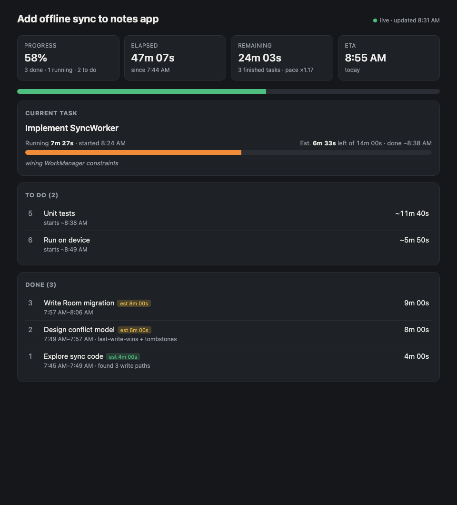

# AIBuildTracker

A Claude Code skill that gives you a live progress page for the work Claude is doing. Say
**"Set up the build tracker for this work"** and Claude splits the job into tasks, opens a page in your
browser, and keeps it current as it goes.



The page shows:

- **Running tasks** (one or several in parallel): how long each has been running, the estimated time left, and when it should finish. It turns red when the task runs over its estimate.
- **To do**: each remaining task with its estimated duration and projected start time.
- **Done**: how long each task took, its start and end times, and Claude's original estimate.
- **Totals**: progress, time elapsed, time remaining, and an overall ETA.

It polls every 2 seconds, so you can leave it open in a tab.

## Install

Requires [Claude Code](https://claude.com/claude-code) and `python3`.

**Option A: plugin (recommended).** Run these inside Claude Code:

```
/plugin marketplace add jakepurple13/AIBuildTracker
/plugin install build-tracker@aibuildtracker
```

**Option B: one-line script.** Copies the skill to `~/.claude/skills/build-tracker`:

```bash
curl -fsSL https://raw.githubusercontent.com/jakepurple13/AIBuildTracker/main/install.sh | bash
```

**Option C: from a clone.**

```bash
git clone https://github.com/jakepurple13/AIBuildTracker.git
cd AIBuildTracker && ./install.sh
```

Restart Claude Code (or start a new session) after installing.

## Usage

Ask Claude to set it up at the start of any multi-step task:

> Set up the build tracker for this work

Claude will:

1. Break the work into tasks, each with a rough estimate in minutes.
2. Start a local server on `127.0.0.1` and open the page in your browser.
3. Mark each task done and start the next one as it works, adding short notes along the way.

You can also drive the tracker yourself:

```bash
T=~/.claude/skills/build-tracker/tracker.py
$T init "Ship feature" "Explore:5" "Implement:15" "Test:10"   # name:minutes
$T start            # begin the next pending task
$T next --note ok   # finish the current task and start the next one
$T note "running tests"
$T add "Write docs" --est 5
$T skip 4 --note "not needed"
$T finish
$T start 3 4 5      # run several tasks in parallel
$T done 4 --note ok # finish one of them; name the task while several are running
$T note "building" --task 3
$T workers 3        # how many tasks run at once, for the ETA
$T status           # text summary
$T url              # print the page URL; restarts the server if it stopped
```

All commands take `--dir DIR`. By default, state lives in `~/.build-tracker/<current folder name>/`.

### How estimates work

- Tasks with an estimate are scaled by how actual time has compared with the estimates so far. The page shows this as the "pace" factor, limited to between 0.5× and 3×.
- Tasks without an estimate use the average time of the finished tasks.
- A running task's time left is its estimate minus the time it has run so far.
- Parallel work: remaining tasks are assigned, in order, to whichever parallel slot frees up first. The number of slots is the most tasks seen running at once, or the value set with `workers N`. The ETA is when the last slot finishes.

Updates hold a file lock, so parallel subagents can update the tracker at the same time (macOS and Linux).

## How it works

- `tracker.py` writes `state.json`, stamping every start and end time itself, so durations are real rather than guessed.
- It serves the folder with Python's built-in `http.server`, bound to `127.0.0.1`.
- `index.html` fetches `state.json` every 2 seconds and updates its clocks every second.
- If the server stops, the page keeps the last data it received and shows "offline". Running `tracker.py url` brings it back.

## Uninstall

```bash
./install.sh --uninstall    # or: curl -fsSL .../install.sh | bash -s -- --uninstall
rm -rf ~/.build-tracker     # optional: remove saved tracker data
```

Plugin installs: `/plugin uninstall build-tracker@aibuildtracker`.

## License

MIT
